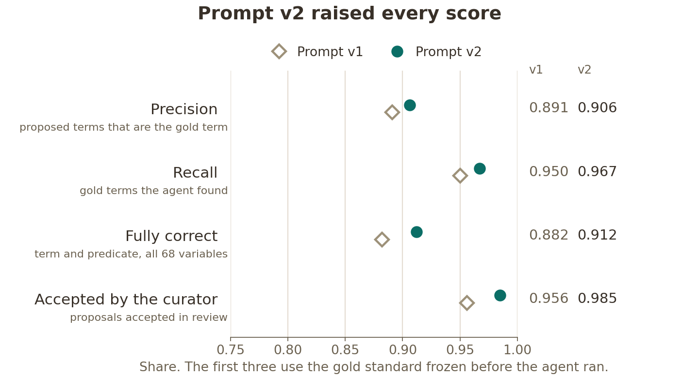

# pd-biomarker-model

A LinkML data model for Parkinson's disease phenotypes and biomarkers, with
ontology-bound value sets, validation rules, FAIR provenance, and an AI
mapping agent whose ontology mappings are reviewed by a curator and scored
against a gold standard. All data is synthetic.

## The problem

Parkinson's cohort data mixes clinical rating scales, diagnoses, symptoms,
fluid biomarkers (alpha-synuclein seed amplification, NfL, proteomics on
SomaScan and Olink) and DaT-SPECT imaging. Each study exports it with its own
variable names and units, so combining studies means two jobs: a shared model
that states what a valid record is, and a mapping from each study's variables
to standard ontology terms. This project does both, and measures how far an
AI agent can be trusted with the second.

## The model

The schema has two layers ([diagram](docs/diagram.md)):

- **Core** ([`core.yaml`](src/pd_biomarker_model/schema/core.yaml)): a
  disease-agnostic cohort model. A dataset holds flat lists of participants,
  visits, diagnoses, phenotype observations, clinical assessments,
  specimens, analytes, assays and biomarker measurements, linked by
  identifier, so each class maps to one table. The dataset, diagnosis and
  assessment classes are abstract.
- **Parkinson's module**
  ([`pd_biomarker_model.yaml`](src/pd_biomarker_model/schema/pd_biomarker_model.yaml)):
  imports the core and narrows it: diagnoses to parkinsonian disorders with
  their published criteria, assessments to MDS-UPDRS, MoCA and Hoehn and
  Yahr. Another disease area would add its own module without changing the
  core.

Value sets are bound to ontologies: MONDO (diseases), HPO (phenotypes),
UBERON (specimens and brain regions), OBI and NCIT (assays), PRIDE
(platforms), LOINC (rating scales), UO-mapped UCUM codes (units), PATO and
STATO. Diseases, phenotypes and brain regions are dynamic value sets that
follow an ontology branch; brain regions exclude the cell types UBERON
relates to the brain. Analytes are identified by UniProtKB accession, so a
protein measured on SomaScan and on Olink is the same analyte, with each
platform's reagent identifier kept on the measurement.

16 cross-field rules sit in the schema: units must match the measurement
type (a ratio is dimensionless, a concentration is in pg/mL or ng/mL, a
SomaScan or Olink value is in RFU or NPX); categorical results carry no
value or unit; imaging values need a brain region and laterality and no
specimen; each rating scale has its score range; motor scores need the
medication state; a person curator is identified by an ORCID.

## FAIR decisions

- **Identifiers**: the schema and every value have a persistent IRI under
  `https://w3id.org/pd-biomarker-model/`; records use CURIEs; proteins use
  UniProtKB.
- **Metadata**: each dataset states its version, licence, creation date,
  schema version and whether it is synthetic.
- **Provenance**: every measurement records its source, curation date,
  curator and whether the curator was a person or an AI agent (mapped to
  `prov:Person` and `prov:SoftwareAgent`). Mappings carry the same in SSSOM.
- **Versioning**: the schema follows semantic versioning with a
  [changelog](CHANGELOG.md).
- **Reuse**: each fixed value set is exported as a SKOS concept scheme, an
  OWL ontology and a TSV in [`vocabularies/`](vocabularies/), ready to load
  into a terminology system; dynamic value sets are exported as their
  defining query.

## Validation

`linkml-validate --config validation.yaml <file>` runs three layers:

- **Structure and rules**: JSON Schema generated from the schema, closed to
  undeclared slots: required slots, ranges, patterns, numeric limits and
  the 16 rules.
- **Ontology terms**: values of dynamic value sets must lie in the expanded
  ontology branch, checked offline against a committed cache. A separate
  check confirms every ontology term in the schema exists, is current and
  has the recorded label.
- **Cross-record rules** (a validation plugin): references resolve,
  identifiers are unique, no visit precedes enrolment, a measurement's
  specimen comes from the same visit, and symptom onset does not follow
  diagnosis.

[`examples/`](examples/) holds two valid synthetic datasets and 29 invalid
files, each breaking one rule; pytest checks that every invalid file fails
for its own rule. CI runs the tests on Python 3.11 to 3.13, lints the
schema, checks every ontology term, and regenerates the JSON Schema, SQL
DDL, Python models, diagram and vocabularies, failing if any committed copy
differs.

## AI-assisted mapping with human review

The task: map a messy synthetic data dictionary of 68 variables
("aSyn SAA (CSF)", "UPDRS3 tot OFF", "GPNMB_SOMA") to ontology terms, with
a predicate (exact, broad, narrow or related) and a confidence, written as
SSSOM. Details are in [`mapping/`](mapping/) and the rules for agent and
curator alike in the [curation guidelines](docs/curation-guidelines.md).

1. **Gold standard first.** A Claude Code agent drafted a mapping; the
   curator reviewed every row (66 accepted, 2 corrected) and it was frozen
   before the mapping agent ran. The SSSOM file keeps each draft with the
   reviewer's agreement and adds the corrections as curator-authored rows.
2. **A blind agent.** The mapping agent is a Claude Code agent
   (claude-opus-5-5) given only a workspace outside the repository with the
   dictionary, the guidelines and an ontology search tool (oaklib over local
   ontology databases, LOINC through a FHIR terminology server). An audit of
   its transcript lists every command it ran and fails if it touched
   anything outside the workspace.
3. **Review.** The curator accepts, rejects or corrects every proposal; the
   decision is recorded in SSSOM (`reviewer_id`, `reviewer_agreement`), and
   a correction is added as a new curator-authored mapping, so the agent's
   original proposal stays visible.
4. **Score, analyse, revise, rerun.** The agent is scored against the frozen
   gold standard, every disagreement is classified, and the prompt and
   guidelines are revised once.



**Prompt v1**: precision 0.891, recall 0.950, predicate agreement 0.982;
60 of 68 variables fully correct (term and predicate). The curator accepted
65 of 68 proposals. Of the eight disagreements with the gold standard, five
were errors in the gold standard that the agent got right (an NCIT assay
plate identifier the gold standard missed, a more specific fasting-status
term, broad and related matches the guidelines allow). Three were agent
errors:

- **Identifier versus entity**: "site" mapped to *Study Site*, though the
  column holds codes naming the site (*Study Site Identifier*).
- **Over-literal definition**: *Age at Diagnosis* judged broader than "age
  when PD diagnosed" because NCIT defines it for a pathologic diagnosis.
- **Diagnosis versus symptom**: clinician-judged depression mapped to the
  MONDO disorder rather than the HPO phenotype.

No unit or specimen errors occurred: molar and mass units went to the right
LOINC property, and "SAA" was never read as serum amyloid A.

**Prompt v2** added one guideline clarification per agent error (written
with examples that are not in the dictionary) and a checklist the agent runs
before writing. Precision rose to 0.906, recall to 0.967 and predicate
agreement to 1.000; 62 of 68 variables were fully correct and the curator
accepted 67 of 68 proposals. All three v1 errors were fixed. The new
diagnosis rule caused the one remaining agent error: PD mild cognitive
impairment went to HPO's broader *Cognitive impairment* instead of NCIT's
*Mild Cognitive Impairment*.

The agent's confidence carried signal: proposals that matched the gold
standard averaged 0.81 (v1) and 0.75 (v2), those that did not 0.53 and 0.50,
so a review queue ordered by confidence puts the disagreements first.

**Limits.** 68 variables is a small set, and v2 was revised on the same
variables it was scored on, so its gain shows the fixes worked rather than
how the agent generalises. The gold-standard draft and the agent are the
same model family, which may share blind spots that agreement would not
reveal; the curator's row-by-row review is the check on that. Each prompt
was run once, so run-to-run variation is not measured.

## How to run

Python 3.11+ with [uv](https://docs.astral.sh/uv/) and
[just](https://github.com/casey/just):

```bash
uv sync --group dev
just test                # schema, Python and example tests
just lint                # linkml-lint
just check-terms         # every ontology term in the schema, offline
just validate-examples   # valid files pass, invalid files fail
just gen-artifacts       # JSON Schema, SQL, Python models, diagram, vocabularies
uv run linkml-validate --config validation.yaml examples/valid/ParkinsonsStudyDataset-001.yaml
```

The mapping workflow (freeze, workspace, audit, import, review, score) is
described in [`mapping/README.md`](mapping/README.md).

## Skills shown

LinkML, YAML, data modelling, ontologies (MONDO, HPO, UBERON, OBI, LOINC,
UCUM), SSSOM, oaklib, SKOS/OWL vocabulary export, FAIR, AI-agent curation
with human review, Python, Git, CI.

## Credits

Built from the [linkml-project-copier](https://github.com/linkml/linkml-project-copier)
template. MIT licence.
