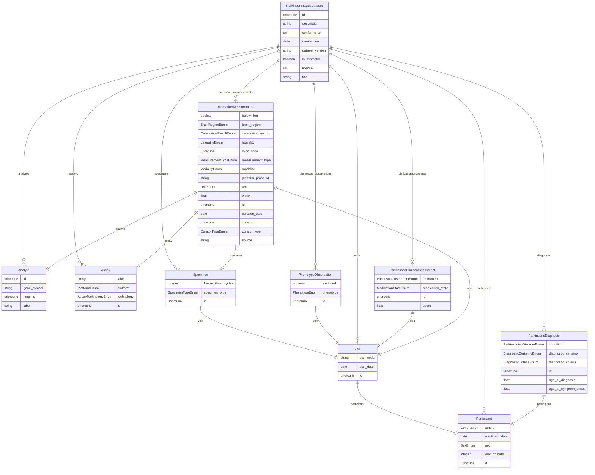

# Model diagram

Entity-relationship diagram of the Parkinson's module and the core it imports, generated from the schema with `gen-erdiagram`. Records refer to each other by identifier; each line shows a reference slot and its cardinality.

